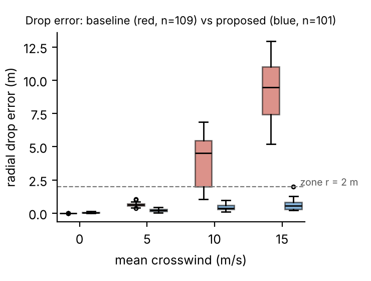
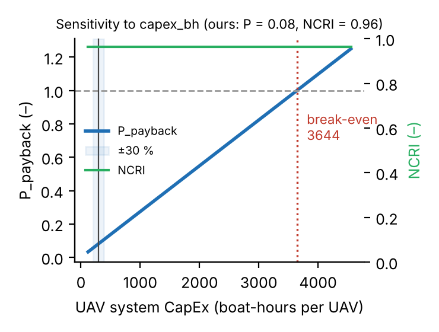
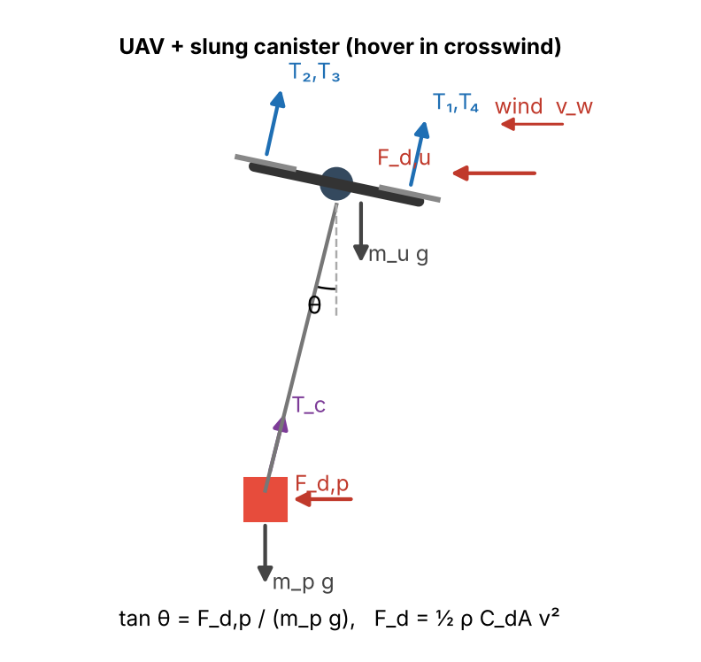
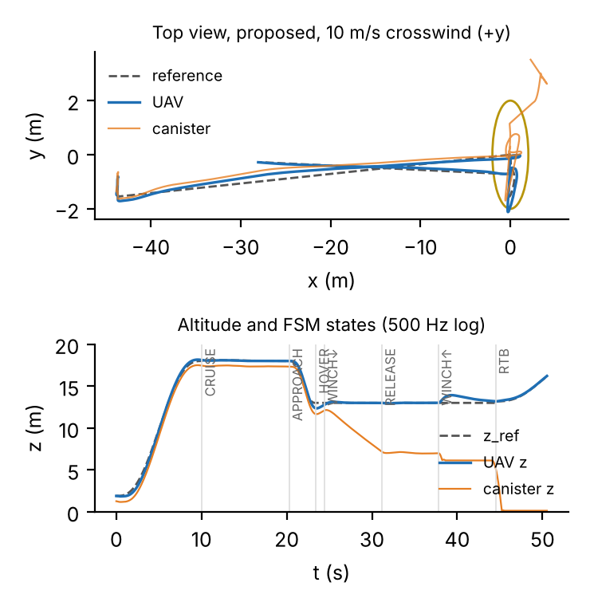
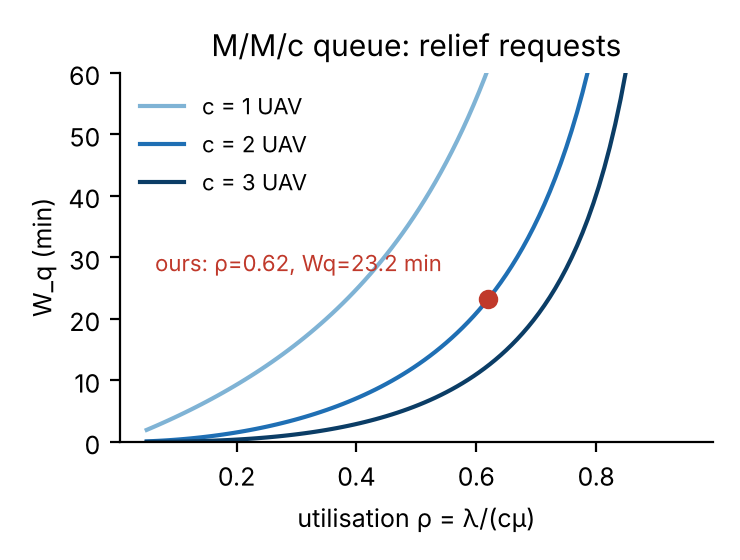

# SkyHydro

**A vision-guided multirotor drone that delivers medicine to flooded rooftops, built and tested in DeepMind MuJoCo, with a reinforcement-learning pilot and a cost model.**

**Author:** Manikya Rathore · B.Tech CSBS, SVKM's NMIMS MPSTME, Mumbai

> *Research question: to what extent can an autonomous vision-guided multirotor UAV simulated in MuJoCo for payload-range trade-offs optimize last-mile medical relief drop accuracy during NDRF flood operations while establishing fleet utilization payback parity against ground transport?*

| Video | Link |
|---|---|
| Project video (3:45) | https://lnkd.in/p/dwu8AHcT |
| Simulation only, Full HD 1080p, no voice-over (3:45) | https://drive.google.com/file/d/1WLYJijy1D3bz0LdORWOzSMSYkpFt4-Bg/view?usp=sharing |

---

## Why

Floods affect about **3.2 crore (32 million) people in India every year** (Central Water Commission, long-term average). When a village is cut off, urgent medicine waits hours for a rescue boat.

A drone can be there in minutes. The hard part is the drop: wind makes a canister hanging on a cable swing like a pendulum, and a drone that releases blindly misses the roof.

## Results at a glance

| | GPS-only drop (baseline) | **SkyHydro vision-guided drop** |
|---|---|---|
| Average miss distance (240 MuJoCo trials, 0–15 m/s crosswind) | 2.82 m | **0.31 m** |
| Unsafe drops (water or off the roof zone) | 34 % | **0.8 %** |
| Successful deliveries | 57 % | **83 %** |
| Path-tracking error (RMSE) | 0.95 m | **0.70 m** |
| Crashes | 0 | **0** |

* **Statistics:** Welch's t = 7.35, **p < 0.001**, Cohen's d = 0.98 (large effect). The 95 % confidence interval of the improvement is 1.84–3.19 m. A Mann–Whitney test agrees.
* **AI pilot (PPO):** **30/30** full valley missions, **150 s** on average, against **309 s** for the hand-programmed pilot.
* **Cost:**
  * A drone delivery costs **3.6 %** of a boat trip (NCRI 0.96).
  * The drone pays back in about **3 months** (P_payback = 0.08).
  * Response time is **34 min** with 2 drones against **222 min** with 4 boats.

| Drop error by wind speed | Business sensitivity |
|---|---|
|  |  |

---

## How it works

### 1. The drone model, `models/skyhydro_flood_uav.xml`
* **Airframe:** quadcopter of **3.355 kg** with 4 rotor motors on their own sites, each giving 0–35 N of thrust plus drag torque for yaw. T/W ≈ 2.2 with a 3 kg canister.
* **Payload:** a winch on a slide joint, a 2-DOF cable pendulum, and a canister held by an equality constraint (release = constraint off). The target is a rooftop at 6 m.
* **Solver:** timestep 0.002 s (500 Hz), RK4 integrator, contact `solref 0.01 1`, friction 0.7.
* **Wind:** quadratic drag (drone CdA 0.10 m², canister 0.08 m²) with Gauss–Markov gusts (σ = 0.1 U, τ = 2 s).
* **Physics check:** at a mean wind of 9.6 m/s, the free-body diagram predicts 9.8° of cable swing; the 500 Hz log shows 9.7 ± 1.2°.



### 2. The controller, `src/flood_relief_drop_sim.py`
* **Mission state machine:** `TAKEOFF → CRUISE → APPROACH_DROP_ZONE → HOVER → WINCH_LOWER → RELEASE → WINCH_UP → RETURN_TO_BASE`, plus `ABORT`.
* **Cascaded control:** position PID → velocity loop → geometric SO(3) attitude control → X-layout mixer to 4 rotor thrusts.
* **What makes the drop accurate:**
  * A downward camera tracks the **canister**, not just the drone: 30 Hz, 5 cm noise, α-β filter.
  * The drone slowly shifts so the canister sits over the target, with aim-off h·tanθ.
  * Anti-sway feedback damps the pendulum.
  * It releases only inside a **steady window**: error under 0.35 m and speed under 0.35 m/s.
* **Safety aborts:**
  * no steady window within 20 s
  * battery reserve below 25 %
  * hang angle above 40° for 3 s



### 3. The flood valley and AI pilot, `environment/`, `rl/`, `simulate.py`
* **Valley:** a procedurally generated 240 × 240 m Himalayan valley (seed 1):
  * terrain and a gorge torrent
  * two flooded towns, with 5 marked houses and 10 survivors on rooftops
  * a relief warehouse on the hill
  * animated flood water from a computed flow field, plus debris and a rescue helicopter
* **Survey scan:** the drone first flies over every house. The blue beam is its camera, building the delivery list.
* **AI pilot:**
  * **Training:** PPO (Stable-Baselines3) with a curriculum. Stage 1 supplies one house, stage 2 two houses, stage 3 the full mission.
  * **Observations (26):** goal direction, velocity, tilt, canister motion, heights, houses left, nearest building.
  * **Actions (4):** velocity command plus hook. The cascaded controller above keeps the drone stable.
  * **Reward:** +15 per pickup, +30 per delivery, +50 for mission complete, −50 for a crash or a canister in the water, small penalties for swing and jerk.
* **Trees:** the trees are scenery, not obstacles. Before any flight is shown, its exact path is computed first and any tree on it is removed from view (`environment/tree_clearance.py`).

### 4. The business model, `analytics/disaster_relief_logistics.py`
* **Units:** every cost is a ratio to **one rescue-boat hour**, so the model has no currency.
* **What it computes:**
  * crew hours reclaimed
  * κ / NCRI
  * payback ratio
  * an **M/M/c queue** (Erlang C) for response time
  * a ±30 % tornado with break-even values
  * an FMEA risk table (top risk: canister swing in crosswind, RPN 280 → 48)



---

## Quick start

### Windows (one click)
1. Install **Python 3.11 or 3.12 (64-bit)** and tick **"Add python.exe to PATH"**.
2. Double-click **`setup_quick_windows.bat`**. It takes 10–20 min the first time: it creates `.venv`, installs the packages and builds the valley.
3. Double-click any demo:

| Demo (`.bat` on Windows, `.sh` on Linux/macOS) | What you see |
|---|---|
| `demo_1_valley_replay` | Survey scan, then the AI pilot's recorded missions in the 3D flood valley |
| `demo_2_valley_live_ai` | The trained AI pilot flies a new mission live |
| `demo_3_vision_drop` | The vision-guided drop in 10 m/s crosswind |
| `demo_4_gps_drop_misses` | The GPS-only drop at 15 m/s: the canister lands in the water |
| `demo_5_battery_abort` | Low battery: the drone cancels and returns to base |

### Linux / macOS
```bash
./setup_quick.sh          # venv + packages + valley
./demo_1_valley_replay.sh # ... or any other demo_*.sh (macOS uses mjpython automatically)
```

**Viewer controls:**
* Left-drag: rotate. Right-drag: pan. Scroll: zoom.
* Double-click an object to follow it.
* The top-left text shows the mission step.

### GPU training setup
`setup_windows.bat` / `setup_linux.sh` also install CUDA PyTorch and run the tests. Then retrain:

```bash
train.bat            # or ./train.sh — stages 1 -> 3, results saved to results/ automatically
```

---

## All commands

Activate the environment first: `.venv\Scripts\activate` on Windows, `source .venv/bin/activate` on Linux/macOS.

```bash
# drop simulation (viewer)
python src/flood_relief_drop_sim.py --view                                   # vision-guided, 10 m/s
python src/flood_relief_drop_sim.py --view --controller baseline --wind 15   # GPS-only, misses
python src/flood_relief_drop_sim.py --view --battery-soc 0.27                # battery-reserve abort

# reproduce every number
python src/flood_relief_drop_sim.py --trials 30            # 240 Monte Carlo runs (15-60 min)
python analytics/analyze_trials.py                         # statistics + figures
python analytics/disaster_relief_logistics.py              # business model + figures
python src/flood_relief_drop_sim.py --trials 30 --replay-run 137 --telemetry run137.csv   # 500 Hz log of any run

# flood valley + AI pilot
python simulate.py                    # live AI pilot (survey scan first)
python simulate.py --replay           # recorded test missions from results/
python simulate.py --policy expert    # hand-programmed pilot
python simulate.py --free-cam         # wide overview camera
python analytics/evaluate_rl_pilot.py --episodes 30        # AI pilot vs expert, 60 missions

# tests
python -m pytest tests -q
```

---

## Repository structure

| Path | Contents |
|---|---|
| `models/skyhydro_flood_uav.xml` | MJCF drop-trial model (drone, rotors, winch, cable, canister, roof) |
| `src/flood_relief_drop_sim.py` | Controller, state machine, wind, Monte Carlo runner, 500 Hz logger, viewer |
| `src/test_env.py` | Toolchain check |
| `environment/` | Valley generator, live water, flow field, tree clearance, textures |
| `rl/` | Gymnasium environment, PPO training, expert pilot, survey scan, results registry |
| `simulate.py`, `train_all.py` | 3D valley viewer; training stages 1 → 3 |
| `results/stage1-3/` | Trained pilots (`model.zip`), `training_summary.json`, `replay.json`; `registry.json` |
| `analytics/` | Trial data (`flood_relief_real_trials.csv`, 240 runs), 500 Hz telemetry, statistics, business model, RL evaluation |
| `docs/figures/` | Result figures |
| `render/` | Flight-path and camera helpers for the valley |
| `tests/` | Model and environment tests |
| `setup_*`, `demo_*`, `sim.*`, `train.*` | One-click setup, demos, viewer and training launchers |

## Data provenance
* **Drop results:** every number comes from `analytics/flood_relief_real_trials.csv`, produced by `src/flood_relief_drop_sim.py` running MuJoCo. Each run stores its seed, so its full 500 Hz log can be regenerated.
* **AI pilot results:** from `analytics/rl_pilot_real_trials.csv`.
* **Economic inputs:** either computed from the trials, or labelled assumptions (`ASSUME` in the business script) that are varied ±30 %.

## Honest limits
* **Simulation only.** No physical drone flights yet.
* **Wind:** quadratic drag with Gauss–Markov gusts, not CFD. Rotor downwash on the canister is not modelled.
* **Vision:** a simulated camera measurement (5 cm noise, 30 Hz). There is no image-processing model.
* **Survey scan:** a scripted flight that reads survivor counts from the scene. The AI pilot learned pickup and delivery, not the scan.
* **Trees:** scenery only. The pilot avoids buildings and terrain; trees on the shown path are removed from view.
* **AI pilot:** about 2× faster than the expert, but its canister swings more (8.9° vs 2.3°).
* **Cost model:** most cost inputs are assumptions, tested with sensitivity analysis.

## Tech stack
Python · MuJoCo · Gymnasium · Stable-Baselines3 (PPO) · PyTorch · NumPy / SciPy · Matplotlib · Pillow
